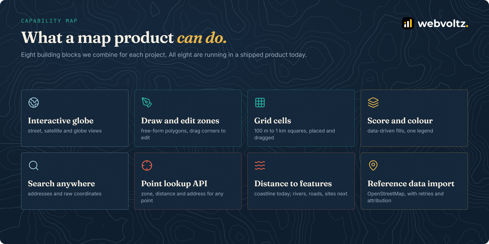

  

# Capability guide

Eight building blocks, each with what it gives users, when you need it, how we build it, and what to watch for. They combine: a risk-zoning tool uses all eight, while a store locator might use three.

- [1. Interactive map and globe](#1-interactive-map-and-globe)
- [2. Draw and edit zones](#2-draw-and-edit-zones)
- [3. Grid cells](#3-grid-cells)
- [4. Score and colour](#4-score-and-colour)
- [5. Search anywhere](#5-search-anywhere)
- [6. Point lookup API](#6-point-lookup-api)
- [7. Distance to features](#7-distance-to-features)
- [8. Reference data import](#8-reference-data-import)
- [Often added next](#often-added-next)

---

## 1. Interactive map and globe

**What users get.** A fast map with street and satellite basemaps. Zoomed out, it becomes a globe, so a portfolio spread across regions reads as one picture. Selecting a zone flies the camera to it and frames it.

**When you need it.** Always. It's the canvas everything else sits on.

**How we build it.** Mapbox GL through react-map-gl, with `projection: 'globe'`. Fly-to uses the zone's bounding box (`turf.bbox` → `fitBounds`) with padding and a maximum zoom, so a tiny zone doesn't fill the screen with one building. On phones, the legend and panels move into a bottom sheet behind an info button, so the map keeps the screen.

**Watch for.** Basemap terms. Mapbox and most providers require their attribution to stay visible, including in screenshots and videos.

---

## 2. Draw and edit zones

**What users get.** Click to trace a boundary, double-click to finish. The area appears as they draw. To change a zone later, they drag its corners.

**When you need it.** Whenever the areas that matter aren't already official boundaries: risk zones, sales territories, service areas, inspection sites.

**How we build it.** Mapbox GL Draw with no default toolbar. The product's own panel starts drawing, so the steps match the form beside it. One shape is kept at a time, and the area is recalculated on every create and update event. Editing loads the zone into `direct_select`. ([`drawPolygon.ts`](examples/drawing/drawPolygon.ts))

**Watch for.** Area must be measured on the Earth, not on the screen: `turf.area` returns square metres on the ellipsoid. Store it, but recalculate it on the server whenever the shape changes, so a tampered client can't send a wrong area.

---

## 3. Grid cells

**What users get.** For precise, comparable areas, a single click drops a square of a chosen size (100 m, 200 m, 500 m or 1 km). Users drag it into place.

**When you need it.** When areas should be uniform: scoring every 500 m cell along a coast, or inspecting a site plot by plot.

**How we build it.** The square is built in ground distance. A degree of latitude is about 111 km everywhere, but a degree of longitude shrinks with the cosine of the latitude, so the cell is widened accordingly. ([`gridCell.ts`](examples/drawing/gridCell.ts)) Dragging uses the map's own pointer events, with a small movement threshold so a click isn't mistaken for a drag, map panning paused while dragging, and touch devices' duplicate "ghost" clicks filtered out.

**Watch for.** A 100 m cell is invisible at country zoom. The product flies the map to street level first, then places the cell.

---

## 4. Score and colour

**What users get.** Every zone carries a rating. The map colours itself by it, and a legend explains the colours.

**When you need it.** Whenever the point of the map is to compare places.

**How we build it.** One data-driven style expression colours every zone on the GPU from its own `score` property. Changing a score is a data update, not a re-render. ([`riskLayer.tsx`](examples/styling/riskLayer.tsx))

**Watch for.** Keep the legend, the popup and the map fill on one shared scale. Defining the bands once and deriving all three from them prevents a "3" that looks orange in the legend and yellow on the map. In the reference project the rating is set by a person (0 to 6); the same layer works unchanged when a score is calculated from data.

---

## 5. Search anywhere

**What users get.** One box for addresses and coordinates. Suggestions appear as they type; pasting "18.47, -69.89" jumps straight there.

**How we build it.** Coordinates are recognised first, with a strict, bounded pattern and range checks, so no geocoding call is needed. Addresses go to a geocoder after the user pauses for 400 ms, once there are at least 3 characters, returning 5 suggestions. ([`searchBox.ts`](examples/search/searchBox.ts))

**Watch for.** Free geocoders have usage policies. OpenStreetMap's Nominatim asks for an identifying User-Agent and at most one request per second, so debounce, cache, and move to a commercial geocoder as volume grows.

---

## 6. Point lookup API

**What users get.** Systems outside the map, such as a quoting tool, a CRM or a mobile app, send a longitude and latitude and get back the zone the point falls in, its distance to the coast, and the street address.

**How we build it.** "Which zone is this point in" is one indexed query in the database ([`pointLookup.sql`](examples/lookup/pointLookup.sql)). The three answers run in parallel, and each fails on its own: if the geocoder is down, the zone and distance still come back, with the address marked unavailable ([`lookupApi.ts`](examples/lookup/lookupApi.ts)). Inputs are range-checked, and the API sits behind authentication with role-based access.

**Watch for.** Coordinate order. GeoJSON and WKT write longitude first; many UIs show latitude first. Convert at the edges and nowhere else.

---

## 7. Distance to features

**What users get.** How far a point, or the nearest edge of a zone, is from the coast.

**How we build it.** Geodesic distance from the point to every nearby coastline line with `turf.pointToLineDistance`, keeping the minimum. For a zone, the closest corner counts, not the centre, so a large zone touching the shore is 0 m away. ([`distanceToCoast.ts`](examples/lookup/distanceToCoast.ts))

**Watch for.** Scale. Measuring against every line works for a region. For a continent, use the spatial index to fetch only nearby lines first.

---

## 8. Reference data import

**What users get.** Coastlines, and the same approach for roads, rivers or boundaries, loaded once and refreshed when needed.

**How we build it.** OpenStreetMap through the Overpass API. Large areas are split into smaller boxes with a pause between them. A busy server moves the import to the next mirror; a full round of failures waits 2 s, 4 s, then 8 s; other errors stop the import. ([`importCoastlines.ts`](examples/data/importCoastlines.ts))

**Watch for.** OpenStreetMap data is under the ODbL: keep "© OpenStreetMap contributors" visible wherever it's shown.

---

## Often added next

These aren't in the reference project, but they're the usual next step for teams who start with the eight blocks above:

| Addition | Typical use |
| --- | --- |
| Heatmaps and clustering | Thousands of points (claims, deliveries, leads) without visual clutter |
| Drive-time and walk-time areas | Catchments and service areas measured in minutes instead of kilometres |
| Calculated scores | A zone's rating derived from data layers (flood, crime, footfall) instead of set by hand |
| Vector tiles | Very large datasets that still load fast |
| Export | GeoJSON, CSV or KML downloads for other GIS tools |
| Time slider | Seeing how zones, risk or demand change over time |
