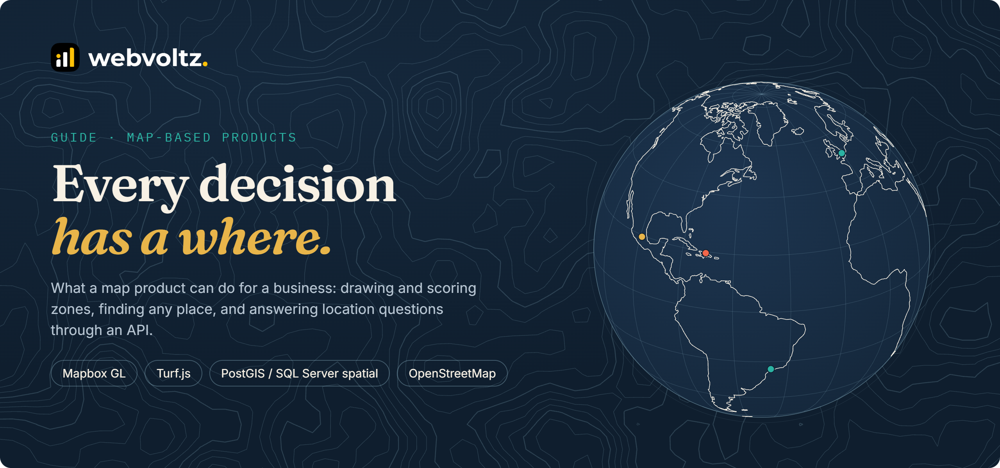
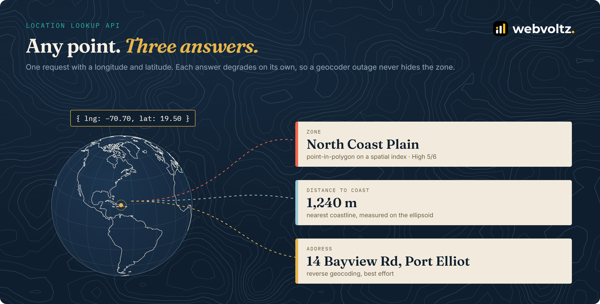
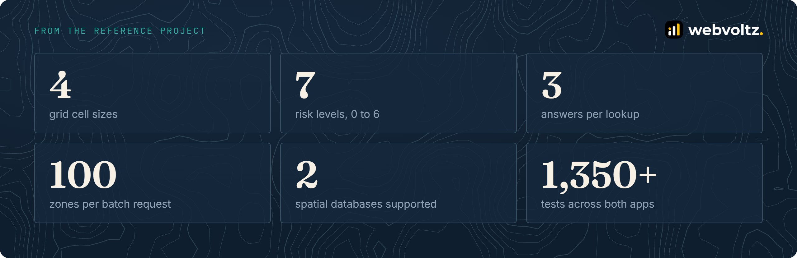
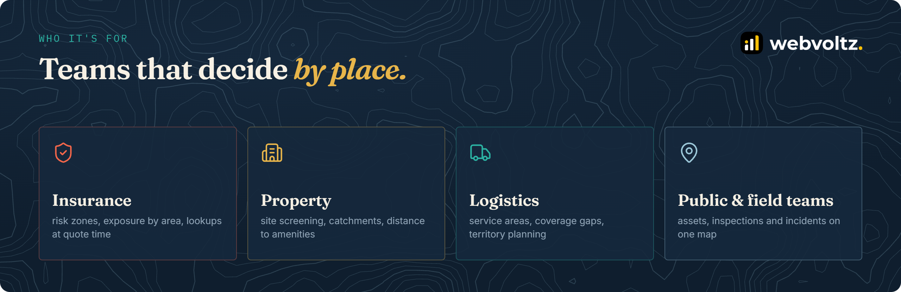
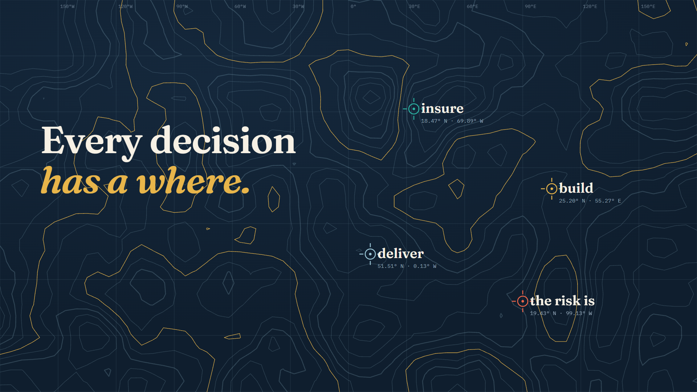

<p align="center">
  
</p>

<p align="center">
  <a href="#what-a-map-product-can-do">Capabilities</a> ·
  <a href="#how-it-comes-together">How it comes together</a> ·
  <a href="CAPABILITIES.md">Capability guide</a> ·
  <a href="ENGINEERING.md">Engineering notes</a> ·
  <a href="#choosing-a-stack">Choosing a stack</a> ·
  <a href="#video">Video</a>
</p>

---

## Why maps

Most business data already has a location in it: a customer's address, a site, a delivery stop, an insured property. In a spreadsheet those are rows. On a map, they become patterns: where risk clusters, where coverage is thin, which sites sit too close to the coast.

A map product turns that into decisions people can make quickly:

- **See it.** Zones and points coloured by what matters, readable at a glance.
- **Shape it.** Draw and edit areas directly on the map, with their size measured for you.
- **Ask it.** Send any coordinate to an API and get back the zone, the distances and the address that matter.

> This is a capability guide, not a single project write-up. The examples come from map products Webvoltz has built and shipped, with client details removed. Code in [`examples/`](examples) is trimmed from production code or written as a reference. See [Notice](#notice).

---

## What a map product can do

<p align="center"></p>

| Building block | What users get | How we build it |
| --- | --- | --- |
| **Interactive map and globe** | Street, satellite and a globe view when zoomed out; smooth fly-to on any zone | Mapbox GL with the globe projection, react-map-gl |
| **Draw and edit zones** | Trace any boundary, then drag its corners to adjust | Mapbox GL Draw, one shape at a time, live area ([`drawPolygon.ts`](examples/drawing/drawPolygon.ts)) |
| **Grid cells** | One click drops a 100 m, 200 m, 500 m or 1 km square; drag to reposition | Cells built on the ground, not the screen ([`gridCell.ts`](examples/drawing/gridCell.ts)) |
| **Score and colour** | Each zone gets a rating; the map colours itself; one legend explains it | A single data-driven style expression ([`riskLayer.tsx`](examples/styling/riskLayer.tsx)) |
| **Search anywhere** | Type an address or paste coordinates | Debounced geocoding plus a strict coordinate parser ([`searchBox.ts`](examples/search/searchBox.ts)) |
| **Point lookup API** | Any longitude and latitude in, three answers out | Spatial index in the database, each answer independent ([`lookupApi.ts`](examples/lookup/lookupApi.ts)) |
| **Distance to features** | How far a point or zone is from the coast | Geodesic distance with Turf ([`distanceToCoast.ts`](examples/lookup/distanceToCoast.ts)) |
| **Reference data import** | Coastlines (or roads, rivers, boundaries) loaded once, kept up to date | OpenStreetMap through Overpass, with retries and attribution ([`importCoastlines.ts`](examples/data/importCoastlines.ts)) |

Each block is described in depth, with when to use it and what to watch out for, in **[CAPABILITIES.md](CAPABILITIES.md)**.

---

## How it comes together

<p align="center"></p>

A typical project has three layers:

1. **The map app.** People draw, rate, search and review zones. Zones are styled on the GPU from their data, so the map stays smooth as zones are added.
2. **The spatial backend.** Zones are stored as real geometry (WGS 84) with a spatial index, so "which zone is this point in" is one indexed query, not a loop.
3. **The lookup API.** Other systems, such as a quoting tool, a CRM or a mobile app, ask location questions without opening the map.

The reference project behind this guide is a risk-zoning tool for an insurer: staff draw and rate zones on the map, and other systems call the lookup API for any coordinate.

---

## By the numbers

<p align="center"></p>

All figures come from the reference project's code. The test count is the number of test cases found in its two repositories' test files (Vitest); it is a count, not a coverage figure.

---

## Who it's for

<p align="center"></p>

The same building blocks fit any team that decides by place: an insurer pricing risk by area, a property team screening sites, a logistics company planning service areas, or a field team tracking assets and inspections.

---

## Choosing a stack

| Need | Our default | When we'd choose differently |
| --- | --- | --- |
| Map rendering | Mapbox GL JS | MapLibre GL for self-hosted tiles and no per-load pricing; Leaflet for very simple maps |
| Geometry in the browser | Turf.js | Server-side only when shapes are large or must be authoritative |
| Spatial database | PostgreSQL + PostGIS | SQL Server spatial when the client already runs SQL Server (the reference project does) |
| Geocoding | A commercial geocoder at scale | OpenStreetMap Nominatim for low volume, with its usage policy respected |
| Reference data | OpenStreetMap | National or commercial datasets when accuracy is regulated |
| Many points | GeoJSON sources | Vector tiles, clustering or server-side aggregation past tens of thousands of features |

The full reasoning, plus the details that make map products correct, is in **[ENGINEERING.md](ENGINEERING.md)**.

---

## Repository map

```text
.
├── README.md            this page
├── CAPABILITIES.md      each building block: what it does, when to use it, how it's built
├── ENGINEERING.md       coordinates, area, indexes, data sources, performance, known limits
├── examples/
│   ├── drawing/         polygon drawing, grid cells
│   ├── styling/         data-driven zone colours, one shared legend scale
│   ├── search/          address and coordinate search
│   ├── lookup/          point-in-zone SQL, lookup API, distance to coast
│   └── data/            OpenStreetMap import
├── assets/              banner, diagrams, brand
└── video/               walkthrough, script and storyboard
```

---

## Video

A 63-second tour in a cartographic style: why location matters, drawing zones, scoring and colouring them, search and globe views, the lookup API, and who it's for. It includes real footage from a shipped product, cropped to the map itself. Script and storyboard are in [`video/`](video).

<p align="center"><a href="video/map-guide.mp4"></a></p>

<p align="center"><a href="video/map-guide.mp4">Watch the video (1:03, 1080p)</a></p>

---

## About Webvoltz

Webvoltz builds the technology systems businesses compete, operate and scale on: web platforms, product engineering, automation, integrations and managed delivery teams. One accountable partner from first strategy session to ongoing delivery.

[**Book a strategy call**](https://webvoltz.com) to talk through a map product, a location API, or putting your own data on a map.

---

## Notice

Copyright © 2026 Webvoltz. All rights reserved.

This repository is published for viewing and evaluation only. Map footage © Mapbox © OpenStreetMap contributors. Coastline data in the graphics: Natural Earth (public domain). See [`NOTICE.md`](NOTICE.md).
